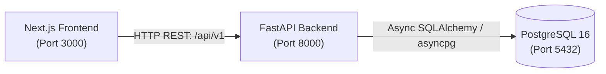

# Phase 1: Architecture & Foundation Design

This document describes the foundational architecture established in Phase 1 of the Smart Shopping Guide project.

---

## 1. System Overview

Smart Shopping Guide is designed as a modular monorepo containing a modern client application, a high-performance asynchronous API, a relational persistence tier, and continuous integration pipelines.

---

## 2. Monorepo Organization

The project uses a structured monorepo pattern to maintain separation between client-side user experience, server-side business logic, infrastructure definitions, and development guides:

- **`/frontend`**: Complete Next.js (App Router) application written in TypeScript with Tailwind CSS. Includes centralized configuration and an isolated API client abstraction layer.
- **`/backend`**: FastAPI backend with layered architecture (API routes -> Services -> Repositories -> Models/Schemas).
- **`/docs`**: System architecture, onboarding instructions, and design references.
- **`/infrastructure`**: Container configurations, database initialization scripts, and operational assets.
- **`.github/workflows`**: Automated continuous integration pipelines for testing, linting, and build validation.

---

## 3. Backend Architecture

### Key Design Choices
1. **Asynchronous Engine**: Leverages Python's `async`/`await` primitives with SQLAlchemy 2.0 `AsyncSession` and `asyncpg` for non-blocking database queries.
2. **Centralized Configuration**: Settings managed via `pydantic-settings` to guarantee strict environment validation and early failure if mandatory keys are missing.
3. **Structured Logging**: Standardized log format configured in `app.core.logging`.
4. **Resilient Health Probes**:
   - `/api/v1/health`: Lightweight status check confirming server liveness.
   - `/api/v1/health/ready`: Database connectivity verification executing `SELECT 1` with 503 fallback upon database disconnection.
5. **Database Migration Strategy**: Alembic is configured with asynchronous connection handling to manage schema revisions safely without manual DDL executions.

---

## 4. Frontend Architecture

### Key Design Choices
1. **App Router**: Uses Next.js App Router for layout composition, metadata handling, and server/client boundary management.
2. **Centralized API Client**: All HTTP communications flow through `src/lib/api/client.ts`, providing centralized timeout handling, uniform response mapping, and error resilience.
3. **Design System**: Emerald brand color scheme (`#059669` primary, `#047857` dark emerald, `#D1FAE5` light emerald, `#FAFAFA` neutral background) built with Tailwind CSS.
4. **Accessibility & Usability**: Semantic HTML tags, clear hierarchy, accessible input controls with IME safe composition handling, and responsive mobile-first navigation.
5. **System Health Indicator**: Development indicator surfacing backend connection status (loading, healthy, error) gracefully without alarming end users.

---

## 5. Security & Isolation
- CORS middleware explicitly configured in FastAPI with whitelist control.
- Credentials segregated into `.env` (excluded by `.gitignore`).
- Zero hardcoded passwords or database connection URIs.
- All errors masked from client exposure to prevent information disclosure.
